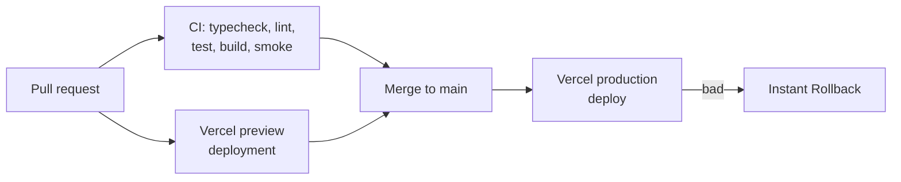

# Engineering overview

## Architecture

Browser clients → Cloudflare DNS (`karaoq.live` zone, DNS-only records) →
Vercel Pro (project `karaoq`, Next.js 14 pages router, serverless API routes)
→ MongoDB Atlas M0. Production is `https://www.karaoq.live`; the apex
redirects to `www`. The app calls the YouTube Data API server-side for search
and corpus harvesting; Vercel crons (`vercel.json`) run the corpus resolver
daily.

The self-host files (`deploy/`, `.github/workflows/deploy-vm.yml`, the
Cloudflare branch in `lib/platform.ts`) are parked, not in use.

## Environments

Production, Vercel previews, CI and dev/local — see
`docs/engineering/environments.md`. There is no staging environment; Vercel
preview deployments are the pre-production check.

## Delivery pipeline

CI (`.github/workflows/ci.yml`) gates every PR and every push to a
non-`main` branch. Every PR branch gets a Vercel preview deployment; a push
to `main` deploys production. Rollback is Vercel's Instant Rollback —
`docs/runbooks/deploy-and-rollback.md`.

## Testing layers

- **Unit/API** — vitest (`pnpm exec vitest run`), mocked Mongo/requests
  (`tests/helpers/`).
- **Smoke** — `pnpm smoke` (`tests/e2e/smoke.mjs`): readonly against any
  deployed URL (preview or production); full mode (writes + cleanup) only
  against local hosts and a non-`karaoq` database, as in `ci.yml`'s `smoke`
  job.
- **Load** — `load/k6-rooms.js`, local targets only for now:
  `docs/runbooks/load-testing.md`.

## Operational practices

- **Feature flags / kill switches** — `lib/featureFlags.ts`, flipped via
  `/api/analytics/flags`; see `docs/runbooks/incident-response.md`.
- **Backups** — nightly Mongo dump to Cloudflare R2 from GitHub Actions
  (`.github/workflows/backup.yml`), restore via
  `docs/runbooks/restore-database.md`.
- **Monitoring** — Vercel dashboard, `/admin`, `/api/health`; no push
  alerting by design: `docs/runbooks/monitoring.md`.
- **Spend** — Vercel Pro spend limit, Settings → Billing:
  `docs/runbooks/monitoring.md`.
- **Secrets** — `docs/runbooks/rotate-secrets.md`.
- **Incidents** — `docs/runbooks/incident-response.md`.
- **Postmortems** — blameless, filed under `docs/postmortems/`
  (`TEMPLATE.md`); see the Aug 2026 YouTube quota and Oct 2026 Vercel Hobby
  limit postmortems there.
- **Branch protection** — `docs/engineering/branch-protection.md`.

## Runbooks index

- `docs/runbooks/deploy-and-rollback.md`
- `docs/runbooks/restore-database.md`
- `docs/runbooks/rotate-secrets.md`
- `docs/runbooks/incident-response.md`
- `docs/runbooks/monitoring.md`
- `docs/runbooks/load-testing.md`
