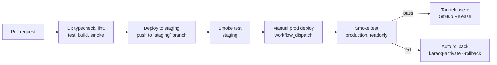

# Engineering overview

## Architecture

Browser clients → Cloudflare (DNS + edge) → Cloudflare Tunnel → Next.js
(`karaoq`/`karaoq-staging` systemd services) on an Oracle Always Free ARM VM
→ MongoDB Atlas. The app also calls the YouTube Data API server-side for
search and corpus harvesting, and cron jobs run the corpus resolver on a
schedule. Full setup: `deploy/README.md`.

## Environments

Production, staging (VM) and dev/local, each with their own database and
(where relevant) YouTube API key — see `docs/engineering/environments.md`.
Production stays on Vercel until DNS cutover to the VM
(`deploy/README.md` "DNS cutover").

## Delivery pipeline

CI (`.github/workflows/ci.yml`) gates every PR and every push to a
non-`main` branch. Deploys run through `.github/workflows/deploy-vm.yml`
(`docs/runbooks/deploy-and-rollback.md`): staging deploys on push to
`staging` or by hand; production is `workflow_dispatch`-only. A successful
production deploy + smoke tags the deployed sha
(`release-<UTC yyyy.mm.dd-HHMM>`) and publishes a GitHub Release with
auto-generated notes — staging never tags. A failed production smoke test
rolls back automatically.

## Testing layers

- **Unit/API** — vitest (`pnpm exec vitest run`), mocked Mongo/requests
  (`tests/helpers/`).
- **Smoke** — `tests/e2e/smoke.mjs`, readonly against a deployed target in
  CI/deploy, full (writes + cleanup) against the CI-only database in
  `ci.yml`'s `smoke` job.
- **Load** — `load/k6-rooms.js` against staging only, once staging has its
  own Atlas cluster: `docs/runbooks/load-testing.md`.

## Operational practices

- **Feature flags / kill switches** — `lib/featureFlags.ts`, flipped via
  `/api/analytics/flags`; see `docs/runbooks/incident-response.md`.
- **Backups** — nightly Mongo dump to Cloudflare R2, restore-tested via
  `docs/runbooks/restore-database.md`; mechanics in `deploy/README.md`
  "Backups".
- **Monitoring** — in-VM health-check timer + external uptime monitor:
  `docs/runbooks/monitoring.md`.
- **Secrets** — `docs/runbooks/rotate-secrets.md`.
- **Incidents** — `docs/runbooks/incident-response.md`.
- **Postmortems** — blameless, filed under `docs/postmortems/`
  (`TEMPLATE.md`); see the Aug 2026 YouTube quota and Oct 2026 Vercel Hobby
  limit postmortems there for what triggered the self-host migration.
- **Branch protection** — `docs/engineering/branch-protection.md`.

## Runbooks index

- `docs/runbooks/deploy-and-rollback.md`
- `docs/runbooks/rebuild-vm.md`
- `docs/runbooks/restore-database.md`
- `docs/runbooks/rotate-secrets.md`
- `docs/runbooks/incident-response.md`
- `docs/runbooks/monitoring.md`
- `docs/runbooks/load-testing.md`
